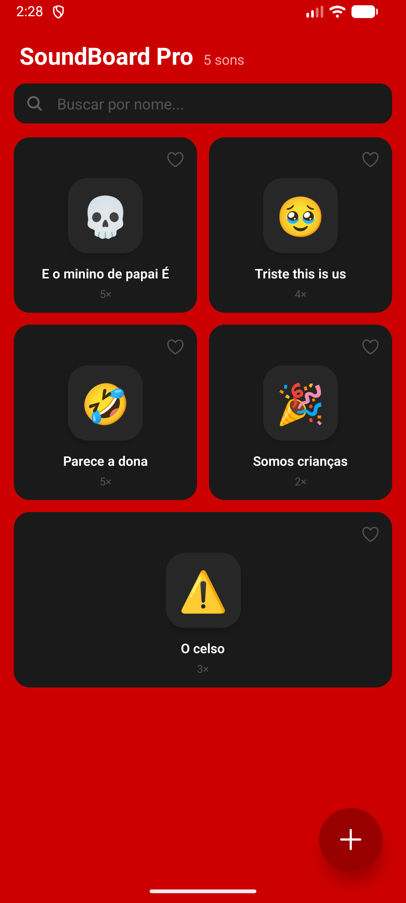
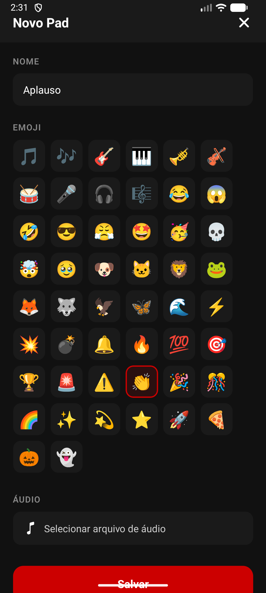
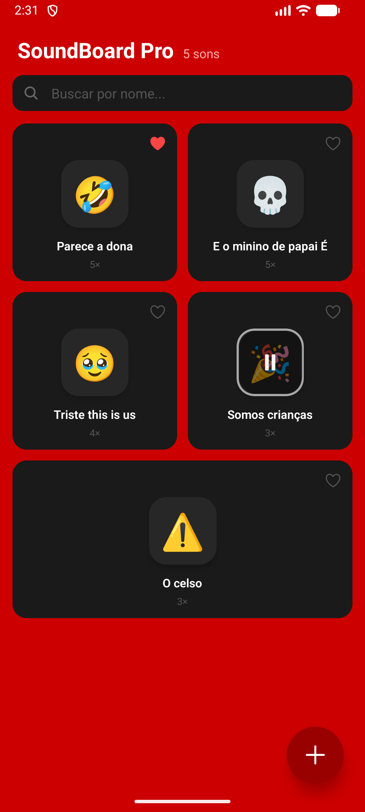
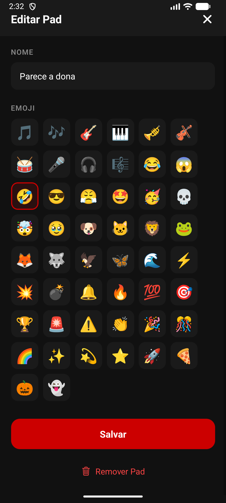

# SoundBoard Pro

**Painel de efeitos sonoros para disparar sons com um toque, direto do celular.**

## Sobre o projeto

Streamers, criadores de conteúdo e qualquer pessoa que precise reagir com um efeito sonoro na hora — uma risada, um aplauso, um "ué" — normalmente dependem de softwares de soundboard para computador, pesados ou pagos. O SoundBoard Pro resolve isso como um app Android nativo: cada som vira um botão colorido com emoji e nome, tocado com um toque e organizado por quem mais usa.

O projeto é pessoal, pensado para uso próprio e distribuição como APK gratuito (sem loja, sem conta, sem login). Está em produção: a interface está completa, os dados persistem em um banco real e o build Android é gerado via EAS.

## Prévia

| **Início** | **Adicionar som** |
|:---:|:---:|
|  |  |

| **Favoritar e tocar** | **Editar ou remover** |
|:---:|:---:|
|  |  |

## Funcionalidades

**Reprodução**
- Toque único inicia ou pausa o som, com feedback tátil e animação no botão
- Contador de reproduções por pad, atualizado sem travar a interface

**Organização**
- Favoritos fixados automaticamente no topo da grade
- Busca em tempo real por nome do pad

**Gerenciamento de pads**
- Criação via botão flutuante: nome, emoji (grade com 50 opções) e upload de áudio (MP3, WAV, OGG, M4A ou AAC)
- Edição de nome e emoji, e remoção do pad e do arquivo associado, via toque longo

**Dados**
- Tudo sincronizado em um banco real, sem necessidade de cadastro ou login

## Arquitetura e stack

| Camada | Tecnologia |
|---|---|
| Interface | Expo (React Native 0.85) + TypeScript |
| Reprodução de áudio | expo-audio |
| Seleção de arquivos | expo-document-picker + expo-file-system |
| Backend e dados | Supabase (PostgreSQL + Storage + função RPC) |
| Build e distribuição | EAS Build (APK Android) |

Ao tocar em um pad, o áudio é reproduzido localmente a partir da URL pública do Supabase Storage, sem esperar o servidor; em paralelo, uma chamada RPC incrementa o contador de reproduções no Postgres sem bloquear a tela. Ao criar um pad novo, o arquivo escolhido no seletor de documentos é copiado para o cache local, convertido e enviado ao bucket de áudio do Supabase; o registro (título, emoji, URL do áudio, posição) é então gravado na tabela `sound_pads`, cujo acesso é liberado por política de RLS para uso pessoal sem autenticação.

## Estrutura do projeto

```
soundboard-pro/
├── src/
│   ├── components/        # SoundPadCard, AddPadModal, EditPadModal, EmojiPicker, FABButton
│   ├── hooks/usePads.ts   # estado central: carregar, criar, editar, favoritar, tocar
│   ├── lib/                # clientes supabase.ts e storage.ts (upload/remoção de áudio)
│   ├── screens/HomeScreen.tsx
│   ├── services/soundPads.ts  # CRUD dos pads + incremento de play count via RPC
│   └── types/index.ts
├── supabase/
│   ├── schema.sql          # tabela sound_pads, RLS, índices
│   └── migrations/
├── docs/portfolio-screenshots/
├── app.json / eas.json     # configuração Expo e perfis de build (preview/production)
└── App.tsx
```

## Como rodar localmente

**Pré-requisitos**
- Node.js 20+
- Um projeto Supabase com a tabela criada a partir de `supabase/schema.sql` e um bucket de Storage chamado `audio` (público)
- Expo Go instalado no celular, ou um emulador Android configurado

**Passos**

```bash
git clone <url-do-repo>
cd soundboard-pro
npm install

# criar .env com as chaves do seu projeto Supabase
cp .env.example .env

npx expo start --go
```

| Serviço | Porta / endereço | Descrição |
|---|---|---|
| Metro Bundler | 8081 | servidor de desenvolvimento do Expo |
| Supabase | projeto remoto (supabase.co) | banco de dados Postgres e Storage de áudio |

Para gerar um APK instalável, com conta EAS configurada:

```bash
npx eas build --platform android --profile preview
```

---

Projeto pessoal desenvolvido do planejamento à distribuição do APK.
